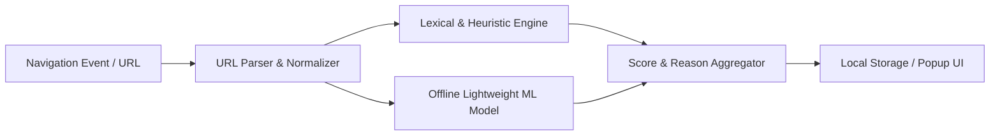

# WebShield Threat Model & Detection Boundaries

This document defines the defensive scope, threat vectors, detection capabilities, and known limitations of the WebShield extension.

---

## 1. System Scope & Architecture

WebShield is a **client-side, privacy-preserving, URL-based detection system** that analyzes top-level address strings within the browser runtime.

### Core Privacy Boundary
Under **Project Rule 6**, WebShield **never** reads, parses, or stores:
- Page DOM content or inner HTML text
- Form input values, session cookies, or tokens
- Keystrokes or typed passwords

Detection is strictly performed on the **Uniform Resource Identifier (URI)** structure and metadata.

---

## 2. What WebShield Detects

WebShield identifies malicious, deceptive, and deceptive-pattern URLs using local heuristics and offline model weights:

### A. Lexical & Structural Anomalies
* **Raw IP Address Usage:** Direct IPv4 (`http://192.168.1.1/login`) or IPv6 addresses used in place of domain names to evade DNS registration.
* **Obfuscated / Encoded IP Addresses:** Hexadecimal, dword, or octal IP encodings.
* **Excessive Subdomain Depth:** Deep nesting used to mask true root domains (e.g., `login.secure.update.paypal.com.account-verification.cc`).
* **Misleading Separators & Prefixes:** Hyphenated brand names (e.g., `paypal-update-account.com`) and `@` symbols utilized to cause browser authority truncation (`https://google.com@evil-site.com`).
* **Abnormal URL Length & Path Entropy:** Disproportionately long query strings, high character entropy, and repetitive encoding indicators often seen in phishing kit redirection chains.

### B. Brand Impersonation & Typosquatting
* **Edit Distance Detection:** Levenshtein and Damerau-Levenshtein distance calculations against a curated local list of frequently targeted domains (e.g., `g00gle.com`, `amaz0n.com`).
* **Combosquatting:** Domain names that concatenate authentic brand names with security/transaction keywords (`chase-security-verify.com`).

### C. IDN Homograph & Punycode Attacks
* **Internationalized Domain Name (IDN) Abuse:** Domains containing mixed scripts or non-Latin lookalike characters (e.g., Cyrillic `а` vs. Latin `a`) rendered via Punycode (`xn--...`).

### D. High-Risk TLD Heuristics
* Identification of free or disproportionately abused top-level domains frequently leveraged in ephemeral, single-use phishing links.

### E. Offline Machine Learning Classification
* Aggregated evaluation using trained lightweight model weights (e.g., Decision Tree or Logistic Classifier) evaluating numerical URL vector representations (token length, character frequencies, digit-to-letter ratios).

---

## 3. What WebShield Does NOT Detect

Because WebShield operates purely on URLs locally without inspecting DOM content or making external API calls, the following attack vectors are explicitly out of scope:

| Threat Category | Description | Why It Is Not Detected |
| :--- | :--- | :--- |
| **Compromised Legitimate Sites** | Legitimate corporate or personal websites that have been compromised to host a phishing form on a valid path. | The domain name and lexical structure are legitimate. Without reading page content or contacting real-time cloud blacklists, the URL appears benign. |
| **Clean-Domain Social Engineering** | Phishing hosted on free-tier legitimate platforms (e.g., Google Forms, Notion, Canva, Microsoft SharePoint). | The root domain belongs to a trusted provider, and URL heuristics alone cannot inspect the document's prompt/contents without violating DOM privacy rules. |
| **Zero-Day Lookalikes Without Lexical Anomalies** | Brand-new domains with unrelated names used for phishing (e.g., `quick-delivery-notice.com`). | If the lexical structure resembles standard web properties and lacks target brand keywords, it will not trigger distance or keyword heuristics. |
| **Drive-By Exploits & Malicious Payloads** | Memory corruption, browser exploits, or malicious binary payloads downloaded from otherwise clean URLs. | WebShield does not inspect downloaded binary content or browser process memory. |
| **Man-In-The-Middle (MITM) & Bypassed Certificates** | Attackers intercepting traffic with rogue root certificates or local proxy tools. | WebShield operates at the application extension layer, not the TLS/network packet inspection layer. |
| **In-Page Overlay / Clickjacking** | Hidden iframes or CSS-rendered fake login prompts loaded inside otherwise benign web applications. | WebShield does not evaluate DOM rendering trees or CSS positioning. |

---

## 4. Mitigation & Defense-in-Depth

WebShield is designed as an **educational, early-warning advisory signal**, not an absolute endpoint firewall. Users should combine WebShield with:
- Standard browser security protections (Safe Browsing).
- Multi-factor authentication (MFA/FIDO2 hardware keys).
- Critical manual inspection of browser address bars.

---

## 5. Security Header Findings: Informational vs. Real Risks

WebShield monitors HTTP response headers on main-frame navigations (`chrome.webRequest.onHeadersReceived`). All missing header detections are recorded as **LOW severity** configuration hygiene findings. 

Not all missing headers constitute an immediate exploit vector. The table below delineates when a finding represents an **informational observation** versus a **real security risk**:

| Defensive Header / Flag | Informational Finding Context | Real Security Risk Context |
| :--- | :--- | :--- |
| **Content-Security-Policy (CSP)** | **Informational:** Static, read-only blogs, personal portfolios, or documentation sites that render no user input and execute no third-party scripts. The absence of CSP poses negligible practical risk here. | **Real Risk:** Webmail, e-commerce, banking, or authenticated single-page applications (SPAs) where lack of CSP permits injected cross-site scripts (XSS) to execute, exfiltrate session data, or perform actions on the user's behalf. |
| **Strict-Transport-Security (HSTS)** | **Informational:** Plain HTTP test servers, local development hosts (`localhost`, `.test`), or domains residing on the hardcoded browser HSTS preload list (e.g., all `.dev` and `.app` domains are HTTPS-enforced at the TLD level). | **Real Risk:** Production banking or transactional sites visited over public/untrusted Wi-Fi networks where attackers can execute SSL-stripping attacks to downgrade HTTPS connections to unencrypted HTTP. |
| **X-Frame-Options (XFO)** | **Informational:** Sites that already configure modern `Content-Security-Policy: frame-ancestors` directives (which supersede XFO in modern browsers), or public marketing pages where framing does not expose sensitive actions. | **Real Risk:** Account settings, funds transfer, or payment confirmation pages lacking framing restrictions, allowing attackers to embed the site in a transparent `<iframe>` for Clickjacking (UI redressing). |
| **X-Content-Type-Options** | **Informational:** APIs or websites that strictly serve hardcoded, trusted MIME types and do not accept user-generated attachments. | **Real Risk:** Web apps with user file upload features (e.g. avatars, documents). Without `nosniff`, browsers may execute an uploaded SVG or text file containing HTML/JavaScript as executable script. |
| **Cookie: Missing `HttpOnly`** | **Informational:** Cookies holding purely client-side preferences (such as light/dark mode UI selection or language toggles) that legitimate client-side JavaScript needs to read. | **Real Risk:** Session identifiers, authentication tokens, or CSRF cookies lacking `HttpOnly`. An attacker exploiting an XSS flaw can access `document.cookie` and hijack the user session. |
| **Cookie: Missing `Secure`** | **Informational:** Local testing environments (`localhost`) where TLS/HTTPS certificates are not provisioned. | **Real Risk:** Authentication or session cookies transmitted over unencrypted HTTP, exposing credentials to passive network sniffing. |

> [!NOTE]
> **Zero Cookie Content Logging (Project Rule 6):** WebShield strictly verifies the presence or absence of defensive flags (`Secure`, `HttpOnly`) in the `Set-Cookie` header attributes. It **never** reads, stores, or logs cookie names, values, or secret authentication payloads.

